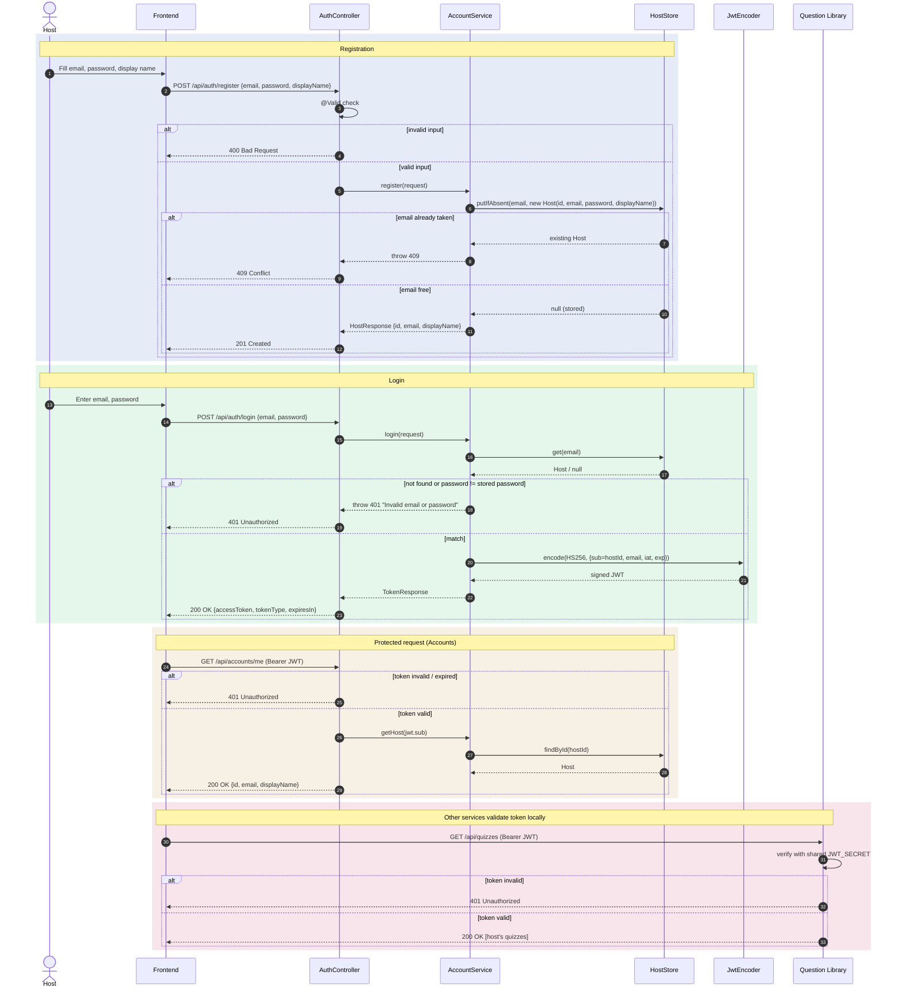

# Accounts Flow

How a host registers, logs in, and uses the token, and how other services check that token without calling Accounts.

Accounts signs tokens with one shared `JWT_SECRET` (HS256). The other services check tokens with the same secret. The token's `sub` claim holds the host's id, which is how other services know who owns a quiz or a room.

## What happens in each block

1. **Registration.** Input is validated, then the host is stored only if the email is not taken yet (`putIfAbsent` makes the check and the insert one step).
2. **Login.** Unknown email and wrong password return the same 401 message, so nobody can find out which emails are registered. On success Accounts returns a signed JWT.
3. **Protected request.** Spring Security checks the token's signature and expiry before the controller runs. The controller reads the host id from `sub`.
4. **Other services.** Question Library, Live Game Sessions, and Scoring verify the same token locally with `JWT_SECRET`. No call to Accounts is needed.
