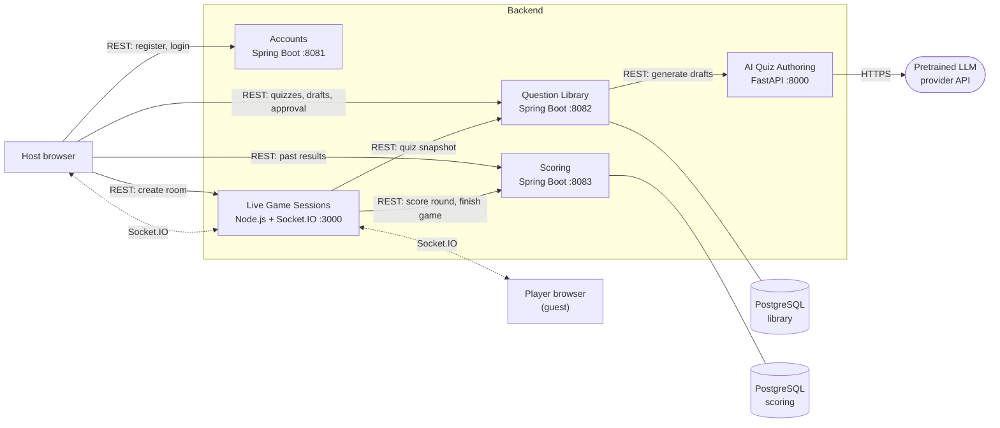

# QuizRoom — Architecture

A host logs in, builds a quiz by hand or from study notes with the help of a language model, reviews and approves the questions, and opens a game room. Guest players join with the room code and a nickname, answer each question the host opens, and see the correct answer and the leaderboard after every round.

**Requirements covered:** five independently runnable services (T01), REST between services and Socket.IO to browsers (T02), one owner per piece of data (T03).

## The 5 services

| Service | Port | Stack | What it does | Its data |
|---|---|---|---|---|
| **Accounts** | 8081 | Java / Spring Boot | Registers hosts, checks their login, issues JWTs | `hosts` (id, email, password, displayName) — in memory for now |
| **Question Library** | 8082 | Java / Spring Boot | Quizzes and questions, draft/approved status, notes and explanations, calls AI for drafts, hands out quiz snapshots | `quizzes`, `questions` in PostgreSQL `library` |
| **Live Game Sessions** | 3000 | TypeScript / Node.js / Socket.IO | Room codes, participants, game state, which question is open, accepted answers, all live events | In memory (a room only lives while the game runs) |
| **Scoring** | 8083 | Java / Spring Boot | Checks answers, awards points, keeps totals and ranks, stores finished games | `games`, `answers`, `scores` in PostgreSQL `scoring` |
| **AI Quiz Authoring** | 8000 | Python / FastAPI | Sends notes to a pretrained language model, parses the JSON answer, validates every draft | None (stateless) |

One PostgreSQL server with a separate database per service. No service reads another service's database; it calls that service's API instead.

## How they talk

- **The browser calls the services over REST** (HTTP + JSON) for everything that is not live: login, quiz editing, creating a room, past results.
- **Question Library calls AI Quiz Authoring** to turn notes into draft questions.
- **Live Game Sessions calls Question Library** once per room to take a fixed snapshot of the quiz.
- **Live Game Sessions calls Scoring** when a question closes (score the round) and when the game ends (store the final result).
- **Real time:** Live Game Sessions runs the Socket.IO server. Host and players stay connected to it during a game and receive participant changes, opened/closed questions, answer counts, and leaderboards.



Solid arrows are REST calls; dotted arrows are live Socket.IO connections.

## Main flow

The full step-by-step sequence is in [game-flow.md](game-flow.md); every endpoint and event is listed in [api.md](api.md).

1. Host logs in (Accounts) and gets a JWT.
2. Host creates a quiz and adds questions by hand or generates drafts from notes (Question Library → AI Quiz Authoring).
3. Host edits, approves, or discards drafts. A quiz with 1–10 approved questions is ready.
4. Host creates a room (Live Game Sessions), which takes a snapshot of the quiz and returns a room code.
5. Players join with the code and a nickname and receive a guest session id.
6. For each question the host opens answering, players submit one answer each, the host closes answering, Scoring awards points, and everyone sees the correct answer and the leaderboard.
7. Host ends the game; Scoring stores the final scoreboard, which the host can open later.

## Security

- **Hosts** send `Authorization: Bearer <JWT>` on every protected call. Each service checks the token itself with the shared `JWT_SECRET`, so no service calls Accounts per request. Ownership is checked with the token's `sub` (host id): a host can only touch their own quizzes, rooms, and results.
- **Socket.IO:** the host passes the JWT in the handshake (`auth.token`); Live Game Sessions only accepts control events from the room's owner.
- **Guests** get a random `sessionId` when they join. Every answer must carry it, so answers are tied to the right participant.
- **Correct answers stay on the server** until a question is closed. `question:opened` contains only the text and the four options.
- **LLM provider key** lives only in the AI Quiz Authoring service's environment.
- When Live Game Sessions calls another service on the host's behalf, it forwards the host's JWT.

## Reliability rules

| Rule | How |
|---|---|
| Timeouts on every service call (T02) | Library → AI: 60 s (models are slow). Sessions → Library / Scoring: 5 s. |
| Defined errors (T02, F11) | REST errors use one JSON shape: `{type, title, status, detail}` (RFC 7807). Socket.IO errors use `{code, message}`. |
| Failure is never success (T02) | If AI is down, the host gets 503 and nothing is saved. If Scoring is down, the question stays closed-but-unscored and the host can retry. |
| Server decides (T05) | Only Live Game Sessions decides if a question is open and if a player may answer. Scores are computed only by Scoring, never taken from a client. |
| Fixed snapshot (T05) | The room copies the approved questions when it is created. Later library edits do not affect a running game. |
| No double counting (T05) | Sessions keeps one accepted answer per player per question. Scoring stores answers with a unique key (game, question, player), so repeating a score request returns the same result instead of adding points again. |
| AI output is checked (T06) | Required fields, question count, non-empty text, four distinct options, valid correct index, and the supporting excerpt must appear in the notes. Failing drafts are dropped. Passing drafts are still only `DRAFT` until the host approves them. |

## Stack

- Java 21 + Spring Boot 3 for Accounts, Question Library, Scoring (Spring Security for JWTs, Spring Data JPA + Flyway for PostgreSQL)
- TypeScript + Node.js + Socket.IO for Live Game Sessions
- Python + FastAPI for AI Quiz Authoring (automatic Swagger docs at `/docs`)
- PostgreSQL, one server, one database per service
- Web frontend with the Socket.IO client
- Configuration through environment variables, one `.env.example` per service (no real secrets)

## Folder layout

```
QuizRoom/
  docs/
  frontend/
  services/
    accounts/              Java / Spring Boot
    question-library/      Java / Spring Boot
    scoring/               Java / Spring Boot
    live-game-sessions/    TypeScript / Node.js / Socket.IO
    ai-quiz-authoring/     Python / FastAPI
```
