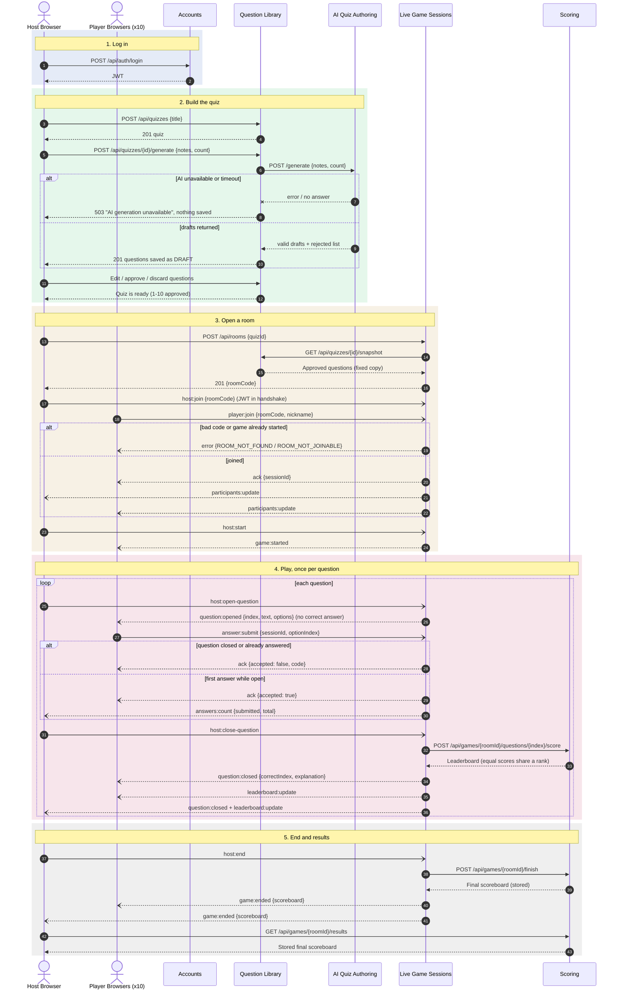

# Game Flow

One complete game: the host logs in, builds a quiz with AI help, opens a room, players join and answer, and the host sees the stored results afterwards.

Solid arrows are REST requests and responses. Open arrowheads are Socket.IO events. Event names and payloads are listed in [api.md](api.md).

## What happens at each stage

1. **Log in (1–2).** Accounts returns a JWT. The host sends it with every later request.
2. **Build the quiz (3–12).** Question Library asks AI Quiz Authoring for drafts. Drafts that fail validation are dropped; the rest are saved as `DRAFT`. If the AI service is down or too slow, the host gets an error and nothing is saved. The host approves the questions they want; editing an approved question makes it `DRAFT` again.
3. **Open a room (13–24).** Live Game Sessions copies the approved questions once, so later edits in the library do not change this game. Players join with the code and a nickname and get a `sessionId`. Everyone sees the participant list update.
4. **Play (25–36).** Only one question is open at a time and there is no timer: the host opens and closes it. Live Game Sessions accepts the first answer from each player while the question is open and rejects everything else. On close, Scoring awards 1 point per correct answer and returns the leaderboard; repeating the same score request gives the same result. Only then do players see the correct answer.
5. **End (37–43).** Scoring stores the final scoreboard, so the host can open it after the room is gone.
