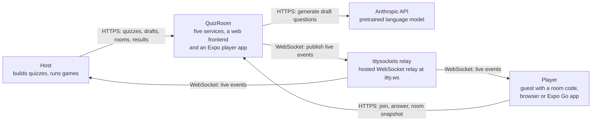
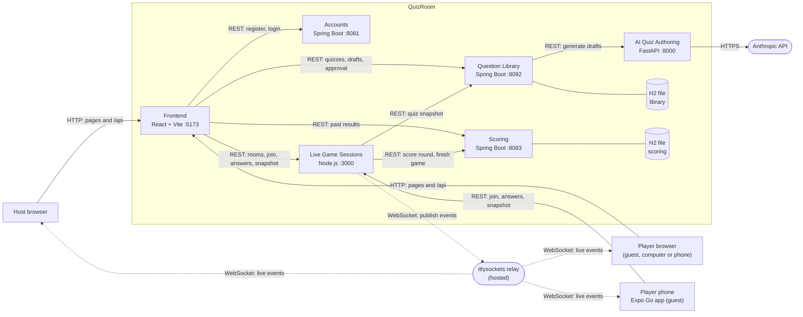
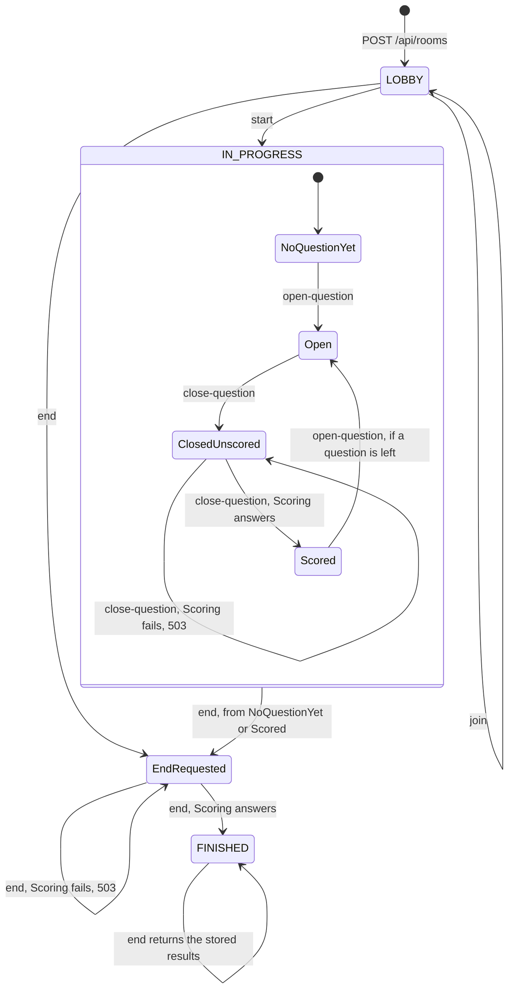

# QuizRoom — Architecture

A host logs in, builds a quiz by hand or from study notes with the help of a language model, reviews and approves the questions, and opens a game room. Guest players join with the room code and a nickname (typed, or by scanning the room's QR code with a phone), answer each question the host opens, and see the correct answer and the leaderboard after every round.

The important decisions and their trade-offs are recorded as ADRs in [adr/](adr/README.md).

## C4 Context

The system as one box, the people who use it, and the outside systems it depends on. Players use either the website in any browser (computer or phone) or the QuizRoom player app in Expo Go on a phone ([ADR 0007](adr/0007-expo-player-app-and-qr-join.md)).



## The 5 services

| Service | Port | Stack | What it does | Its data |
|---|---|---|---|---|
| **Accounts** | 8081 | Java / Spring Boot | Registers hosts, checks their login, issues JWTs | `hosts` (id, email, password, displayName), in memory with plaintext passwords ([ADR 0004](adr/0004-accounts-in-memory-plaintext.md)) |
| **Question Library** | 8082 | Java / Spring Boot | Quizzes and questions, draft/approved status, notes and explanations, calls AI for drafts, hands out quiz snapshots | `quiz`, `question`, `question_options` in an H2 file database (`data/library`) |
| **Live Game Sessions** | 3000 | TypeScript / Node.js / itty-sockets | Room codes, participants, game state, which question is open, accepted answers, room snapshots, publishes all live events | In memory (a room only lives while the game runs) |
| **Scoring** | 8083 | Java / Spring Boot | Checks answers, awards points, keeps totals and ranks, stores finished games | `game`, `participant` (running score), `scored_question` in an H2 file database (`data/scoring`) |
| **AI Quiz Authoring** | 8000 | Python / FastAPI | Sends notes to a pretrained language model, parses the JSON answer, validates every draft | None (stateless) |

Each service that stores data has its own embedded H2 database file, so nothing has to be installed and data survives restarts ([ADR 0003](adr/0003-h2-file-databases.md)). No service reads another service's database; it calls that service's API instead. Why there are five services at all is in [ADR 0001](adr/0001-five-services.md).

## How they talk

- **The browser sends every action over REST** (HTTP + JSON): login, quiz editing, creating and controlling a room, joining, submitting answers, loading the room snapshot, past results.
- **The Expo player app** (`project/mobile`) is a second, player-only client. It calls Live Game Sessions directly (join, answer, room snapshot) with the same REST contract, listens on the same relay channel, and follows the same [reconnect and resync](#reconnect-and-resync) rules as the website. It has no host features and never calls Accounts, Question Library or Scoring.
- **Question Library calls AI Quiz Authoring** to turn notes into draft questions. This is one synchronous call ([ADR 0005](adr/0005-synchronous-ai-generation.md)).
- **Live Game Sessions calls Question Library** once per room to take a fixed snapshot of the quiz.
- **Live Game Sessions calls Scoring** when a question closes (score the round) and when the game ends (store the final result).
- **Real time goes through [ittysockets](https://ittysockets.com/)**, a hosted WebSocket relay ([ADR 0002](adr/0002-ittysockets-relay.md)). Each room gets its own relay channel. Live Game Sessions is the only one allowed to send on it; host and players only listen, and receive participant changes, opened/closed questions, answer counts, and leaderboards.

### How a room uses the relay

1. When a room is created, Live Game Sessions connects first to a channel with an unguessable name (`quizroom-<uuid>`) and sets two keys: a `joinKey` (needed to connect) and a `sendKey` (needed to send). The `sendKey` never leaves the service.
2. The host and every player get the channel name and `joinKey` from Live Game Sessions over REST, so only people in the room can listen.
3. Clients connect without the `sendKey`, so the relay rejects anything they try to send. A player cannot fake a "question closed" or a leaderboard.
4. Players connect with `as: <participantId>` and `announce: true`. The relay tells Live Game Sessions when that participant joins or leaves, which drives the participant list.
5. The channel disappears when the last connection closes; Live Game Sessions disconnects when the game ends. If a connection drops, it reconnects with backoff and jitter. Events that Live Game Sessions publishes while its own connection is down wait in its process and are sent after it reconnects; a listener that was disconnected still misses events and repairs its state from the room snapshot (see [Reconnect and resync](#reconnect-and-resync)).

### C4 Container view

The containers inside QuizRoom and how they connect.



The Expo app's JavaScript bundle is served to Expo Go by the Metro dev server (`project/mobile`, port 8090) during development; Metro is not part of a running game, so it is left out of the diagram.

Solid arrows are REST calls; dotted arrows are live WebSocket connections through the ittysockets relay. In development the frontend's Vite server forwards each `/api/...` path to the service that owns it, so the browser talks to one origin. The Expo app has no such proxy: it calls Live Game Sessions at `http://<host>:3000`, where `<host>` is the computer's LAN address that Expo Go used to reach Metro (`EXPO_PUBLIC_LGS_URL` overrides it).

## Room lifecycle

This is the state machine in `project/services/live-game-sessions/src/rooms.ts`. `status` is `LOBBY`, `IN_PROGRESS` or `FINISHED`. Inside `IN_PROGRESS` the current question is open, closed but not scored yet, or scored.



`close-question` moves an open question to closed-unscored at once and then calls Scoring; when Scoring answers, the question is scored and the answer is published. `EndRequested` is not a separate `status` value: the room keeps its status and sets `endRequested`. A failed `end` leaves the room there until a retried `end` succeeds. A room in any state that gets no requests for 4 hours is removed the next time any room is created.

Requests rejected with 409 `INVALID_STATE`:

| State | Rejected |
|---|---|
| `LOBBY` | open-question, close-question |
| `IN_PROGRESS`, no question yet | start, close-question |
| Question open | start, open-question, end |
| Closed but unscored | start, open-question, end |
| Scored | start, close-question, open-question when no question is left |
| End requested | start, open-question, close-question |
| `FINISHED` | start, open-question, close-question |

Other rejections: `join` outside the lobby or after end was requested gives 409 `ROOM_NOT_JOINABLE`; an answer when no question is open gives 409 `QUESTION_CLOSED`.

## Main flow

The full step-by-step sequence is in [game-flow.md](game-flow.md); every endpoint and event is listed in [api.md](api.md).

1. Host logs in (Accounts) and gets a JWT.
2. Host creates a quiz and adds questions by hand or generates drafts from notes (Question Library → AI Quiz Authoring).
3. Host edits, approves, or discards drafts. A quiz with 1–10 approved questions is ready.
4. Host creates a room (Live Game Sessions), which takes a snapshot of the quiz, opens a relay channel, and returns a room code.
5. Players join with the code and a nickname (the host's room screen shows a QR code for `http://<LAN-IP>:5173/#/join/<CODE>`, which opens the website's join page and can also be read by the app's scanner), receive a guest session id and the channel details, and start listening on the relay.
6. For each question the host opens answering, players submit one answer each, the host closes answering, Scoring awards points, and everyone sees the correct answer and the leaderboard.
7. Host ends the game; Scoring stores the final scoreboard, which the host can open later.

## Security

- **Hosts** send `Authorization: Bearer <JWT>` on every protected call. Each service checks the token itself with the shared `JWT_SECRET` (HS256), so no service calls Accounts per request. Each service also requires `iss = "quizroom-accounts"` and its own name in `aud` (`quizroom-accounts`, `quizroom-library`, `quizroom-scoring`, `quizroom-sessions`); otherwise the token is rejected with 401 like an invalid one ([ADR 0006](adr/0006-jwt-shared-secret.md)). Ownership is checked with the token's `sub` (host id): a host can only touch their own quizzes, rooms, and results.
- **Room control** (start, open, close, end) is REST with the host's JWT; Live Game Sessions only accepts it from the room's owner.
- **Guests** get a secret `sessionId` and a public `participantId` when they join. Every answer must carry the `sessionId`, so answers are tied to the right participant. The `participantId` is what other clients see on the relay, so nobody can learn another player's `sessionId`.
- **Room snapshot** is only returned in full to the room's host (JWT) or a player of the room (`X-Session-Id` header). Everyone else gets only the status. Credentials never go in the URL.
- **Relay channel:** unguessable name plus `joinKey` so only the room can listen; `sendKey` kept on the server so only Live Game Sessions can publish. The itty-sockets client puts these keys in the `wss://` URL query string, an accepted risk described in [ADR 0002](adr/0002-ittysockets-relay.md).
- **Correct answers stay on the server** until a question is scored. `question:opened` contains only the text and the four options, and the snapshot has no `reveal` until the current question is scored.
- **LLM provider key** lives only in the AI Quiz Authoring service's environment.
- When Live Game Sessions calls another service on the host's behalf, it forwards the host's JWT.
- **Passwords** are stored in plaintext in memory in Accounts. This does not meet T04; see [ADR 0004](adr/0004-accounts-in-memory-plaintext.md).

## Reliability rules

| Rule | How |
|---|---|
| Timeouts on every service call (T02) | Library → AI: 120 s (the model can take a while; AI Quiz Authoring keeps its own work under 100 s). Sessions → Library, Scoring and the relay connect: `SERVICE_TIMEOUT_MS`, default 5000 ms. |
| Defined errors (T02, F11) | REST errors use one JSON shape: `{type, title, status, detail}` (RFC 7807). Live Game Sessions adds a `code` field (for example `ROOM_NOT_FOUND`). |
| Failure is never success (T02) | If AI is down, the host gets 503 (504 on a timeout) and nothing is saved. If Scoring is down, the question stays closed-but-unscored and the host can retry. |
| Server decides (T05) | Only Live Game Sessions decides if a question is open and if a player may answer. Scores are computed only by Scoring, never taken from a client. |
| Fixed snapshot (T05) | The room copies the approved questions when it is created. Later library edits do not affect a running game. |
| No double counting (T05) | Sessions keeps one accepted answer per player per question. Scoring records each scored question once per game (a unique key on game and question index, plus optimistic locking on the game), so repeating a score request returns the current leaderboard without adding points again. |
| AI output is checked (T06) | Required fields, question count, non-empty text, four distinct options, valid correct index, and the supporting excerpt must appear in the notes. Failing drafts are dropped. Passing drafts are still only `DRAFT` until the host approves them. |
| Lost live events are repaired | Every event has an `eventId`; clients load the room snapshot on (re)connect and when they see a gap. See below. |

## Quality attributes

Measurable targets, where they live in the code, and whether a test checks them. "Unit test" means the service's own automated tests; "e2e" means `project/services/live-game-sessions/e2e/full-flow.ts`, which runs against the real services and the real relay and is started by hand ([setup.md](setup.md#end-to-end-test-t08)).

| Attribute | Target | Where | Checked by |
|---|---|---|---|
| Room size | At most 100 players per room; the 101st join gets 409 `ROOM_FULL` | `MAX_PLAYERS` in `rooms.ts` | Unit test "rooms are capped at 100 players" |
| Concurrent players | 1 host and 10 players answering at the same time: every answer accepted once, `answers:count` reaches 10/10 | Live Game Sessions | Unit test "one host and ten players join and answer concurrently"; e2e with 10 players. More than 10 at once is a target, not tested |
| Service call timeout | Sessions → Library, Scoring and relay connect give up after `SERVICE_TIMEOUT_MS` (default 5000 ms) and answer 503 | `server.ts`, `services.ts` | Unit test "slow library gives 503 within the timeout" checks the mechanism with a shorter timeout; the 5000 ms default is configuration and is not tested |
| AI generation time | AI Quiz Authoring finishes within 100 s, inside Question Library's 120 s timeout, so the host always gets drafts or a defined error | `BUDGET_SECONDS` in `generator.py`, `AI_TIMEOUT` in Question Library | Unit tests: AI service does not retry past the budget; Library saves nothing when AI is unavailable or too slow. Real model times are measured by [ai-evaluation.md](ai-evaluation.md), not by tests |
| Room memory | A room with no requests for 4 h is removed the next time a room is created | `roomTtlMs` in `app.ts` | Unit test "idle rooms expire and their channel is closed" checks the mechanism with a 100 ms TTL; the 4 h default is configuration and is not tested |
| Scoring outage | If Scoring fails on close, nothing is revealed and the host retries by calling close again; points are added once | `app.ts`, Scoring unique key | Unit tests in Live Game Sessions and Scoring (repeated and concurrent scoring); e2e outage step only when `E2E_STOP_SCORING` and `E2E_START_SCORING` are set |
| Answer secrecy | The correct answer is never sent to a client before the reveal, neither in events nor in the snapshot | `app.ts`, `rooms.ts` | Unit tests "question:opened never carries the answer" and "the answer appears only after scoring"; e2e checks `question:opened` |
| Reconnect | Server, browser and Expo app reconnect with exponential backoff and full jitter, capped at 30 s | `relay.ts`, `live.tsx`, `project/mobile/src/net.ts` | Unit test for the server relay; the Expo app's resync rules are unit-tested in `project/mobile/src/core.test.ts`; the browser and app reconnect loops are not covered by automated tests |

## Reconnect and resync

The relay delivers each message at most once and keeps nothing, so a client that was disconnected misses events. Four rules repair that:

1. **Envelope.** Every message Live Game Sessions publishes is `{ type, version: 1, eventId, ...payload }`. `eventId` is a per-room counter: it starts at 0 and each publish adds 1, so the first event has `eventId` 1.
2. **Snapshot.** `GET /api/rooms/{code}` returns the full room state to the host (JWT) or a player of the room (`X-Session-Id`), including the `eventId` it matches. The correct answer is in it only after the current question is scored. Details in [api.md](api.md#room-snapshot).
3. **Reconnect.** The Live Game Sessions relay connection (`project/services/live-game-sessions/src/relay.ts`), the browser (`project/frontend/src/live.tsx`) and the Expo app (`project/mobile/src/net.ts`) reconnect after `Math.random() * Math.min(30000, 1000 * 2 ** attempt)` ms. `attempt` starts at 0, goes up by 1 after each scheduled reconnect, and goes back to 0 after a successful open.
4. **Client resync.** The page (and the Expo app) loads the snapshot when it mounts and again every time the relay connection opens. It keeps `lastEventId`:
   - an event with `eventId <= lastEventId` is ignored (already seen);
   - an event with `eventId > lastEventId + 1` means a gap: the event is applied and a fresh snapshot is loaded;
   - a snapshot with `eventId >= lastEventId` replaces the state and sets `lastEventId`; an older snapshot causes one more snapshot request;
   - events without a numeric `eventId` are ignored.

## Stack

- Java 21 + Spring Boot 3 for Accounts, Question Library, Scoring (Spring Security for JWTs, Spring Data JPA for the database)
- TypeScript + Node.js 24 (22.18+) for Live Game Sessions, with the `itty-sockets` npm package to publish on the relay
- Python + FastAPI for AI Quiz Authoring (automatic Swagger docs at `/docs`)
- H2 embedded database in file mode, one file per service
- React + TypeScript + Vite frontend. Its dev server forwards each `/api/...` path to the service that owns it, so the browser talks to one origin (no CORS). Live events come through the `itty-sockets` client.
- Expo (React Native + TypeScript) for the player app, run in Expo Go during development, with the `itty-sockets` client for live events and the camera for the QR scanner
- Configuration through environment variables, one `.env.example` per service (no real secrets)

### Note on real-time

T02 names Socket.IO for live events. This project uses ittysockets instead, a free hosted relay with no uptime guarantee. Live games therefore need an internet connection, even when all services run locally. The reasons and costs are in [ADR 0002](adr/0002-ittysockets-relay.md).

## Decisions

| ADR | Decision |
|---|---|
| [0001](adr/0001-five-services.md) | Five separately deployed services |
| [0002](adr/0002-ittysockets-relay.md) | Hosted ittysockets relay instead of Socket.IO |
| [0003](adr/0003-h2-file-databases.md) | Embedded H2 file databases |
| [0004](adr/0004-accounts-in-memory-plaintext.md) | Accounts in memory with plaintext passwords (does not meet T03/T04) |
| [0005](adr/0005-synchronous-ai-generation.md) | Synchronous AI generation call |
| [0006](adr/0006-jwt-shared-secret.md) | HS256 shared secret with issuer and audience checks |
| [0007](adr/0007-expo-player-app-and-qr-join.md) | Expo Go player app next to the website, one QR code for joining |

## Folder layout

```
QuizRoom/
  README.md                  course README (name, neptun)
  project/
    README.md                project README and timeline
    docs/                    these documents
      adr/                   architecture decision records
    frontend/                React / TypeScript / Vite
    mobile/                  Expo player app (Expo Go)
    services/
      accounts/              Java / Spring Boot
      question-library/      Java / Spring Boot
      scoring/               Java / Spring Boot
      live-game-sessions/    TypeScript / Node.js / itty-sockets
      ai-quiz-authoring/     Python / FastAPI
```
