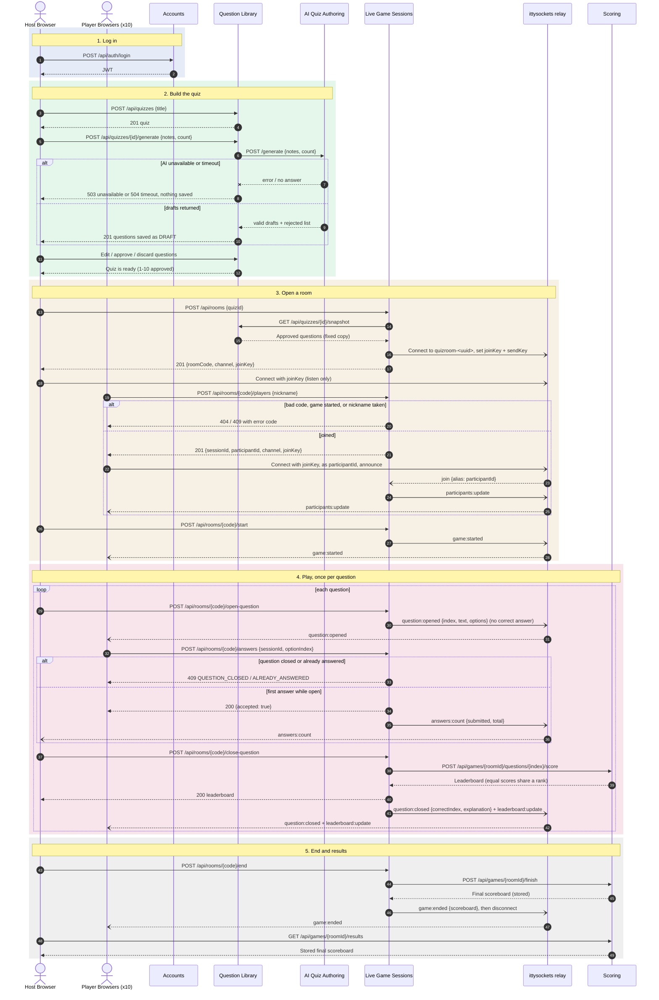

# Game Flow

One complete game: the host logs in, builds a quiz with AI help, opens a room, players join and answer, and the host sees the stored results afterwards.

Solid arrows are REST requests and responses. Open arrowheads are WebSocket messages through the [ittysockets](https://ittysockets.com/) relay. Every event Live Game Sessions publishes reaches the host and all players; the diagram draws it once to keep it readable. Every event also carries `version` and a per-room `eventId`, and a client that misses events reloads the room snapshot; see [api.md](api.md) for event names, payloads and the snapshot.

## What happens at each stage

1. **Log in (1–2).** Accounts returns a JWT. The host sends it with every later request.
2. **Build the quiz (3–12).** Question Library asks AI Quiz Authoring for drafts. Drafts that fail validation are dropped; the rest are saved as `DRAFT`. If the AI service is down or too slow, the host gets an error and nothing is saved. The host approves the questions they want; editing an approved question makes it `DRAFT` again.
3. **Open a room (13–28).** Live Game Sessions copies the approved questions once, so later edits in the library do not change this game. It opens a relay channel that only it can publish on. Players join over REST, get a secret `sessionId` and a public `participantId`, and connect to the channel to listen. The relay reports each connect and disconnect, and Live Game Sessions publishes the updated participant list.
4. **Play (29–42).** Only one question is open at a time and there is no timer: the host opens and closes it. Live Game Sessions accepts the first answer from each player while the question is open and rejects everything else. On close, Scoring awards 1 point per correct answer and returns the leaderboard; repeating the same score request gives the same result. Only then is the correct answer published.
5. **End (43–49).** Scoring stores the final scoreboard, so the host can open it after the room is gone.
